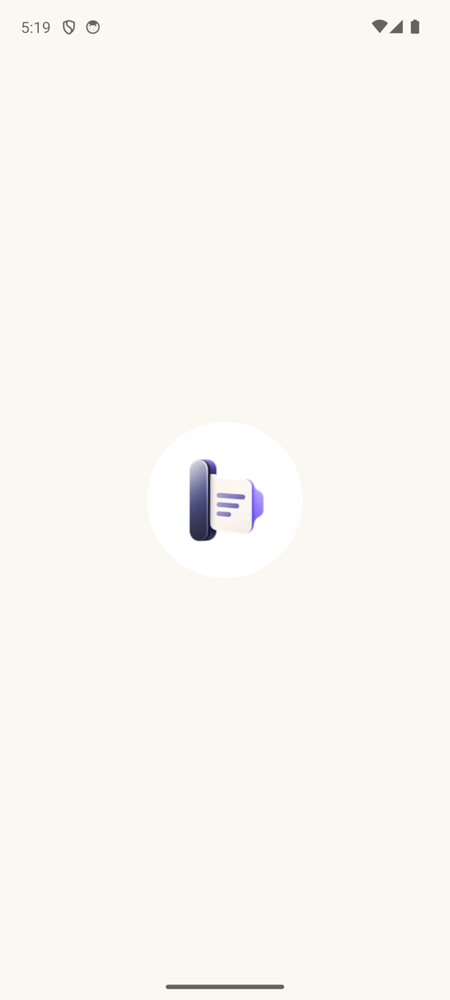
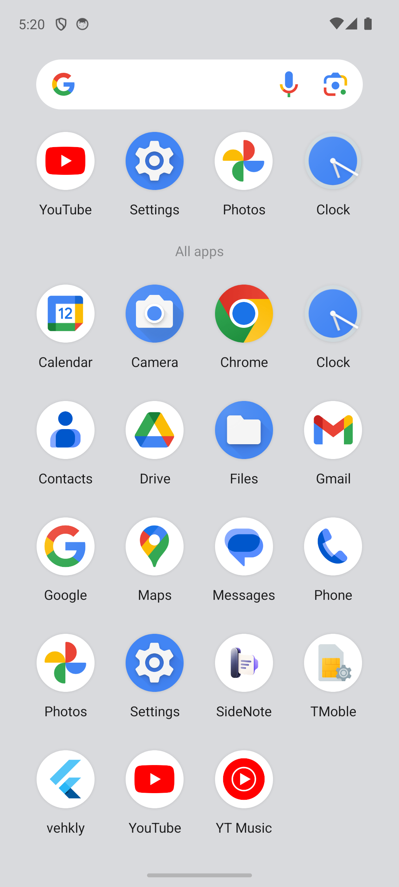
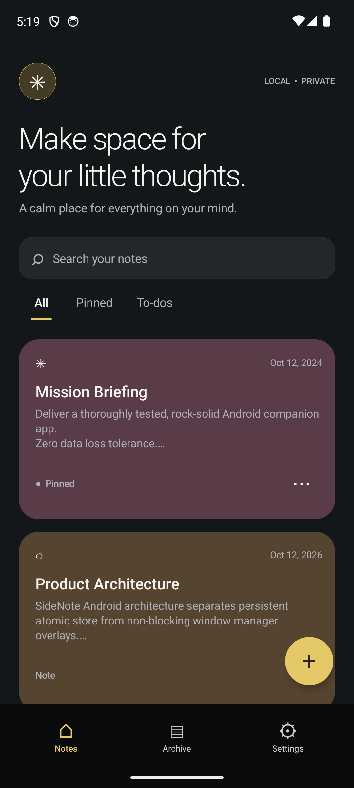
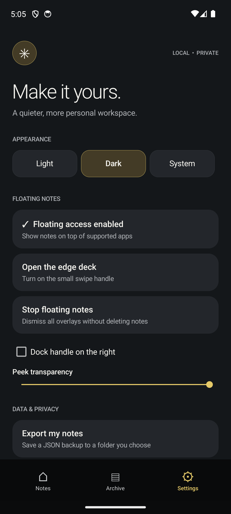
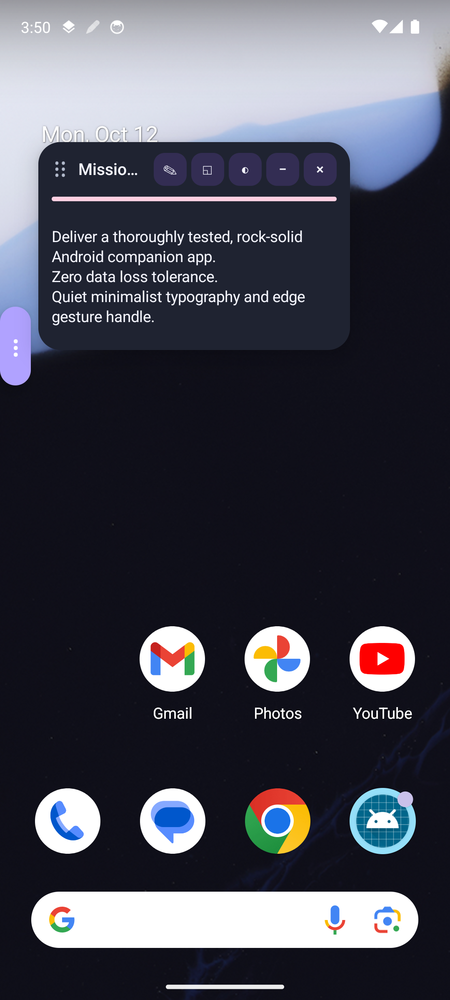
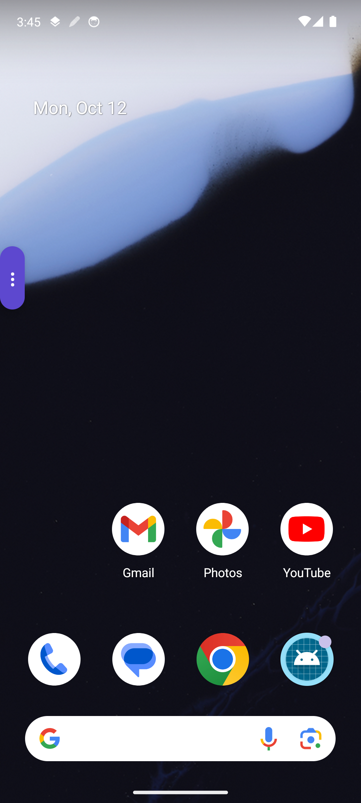
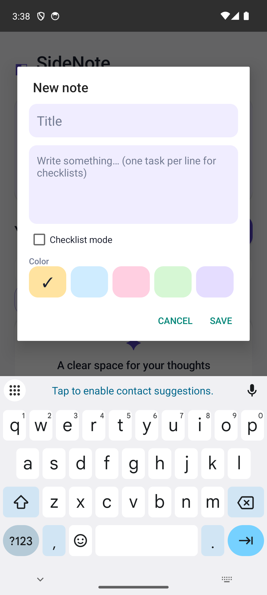

# SideNote Android (v2.3)



A high-performance, quiet floating sidebar and editorial notes application for Android. SideNote provides an always-accessible slim edge handle, quick notes stream, interactive checklists, and independent multi-window floating cards that stay responsive across any app.

---

## Highlights & Features

- **Quiet Slim Edge Handle:** Docks unobtrusively on the left or right screen edge with zero battery impact and smooth touch gesture interactions.
- **Floating Multi-Window Cards:** Open multiple independent floating note windows simultaneously with dragging, opacity adjustment, resizing, and minimize-to-pill transitions.
- **Editorial Notes & Interactive Checklists:** Rich note editing with auto-save, tag filtering, pin/archive management, search, and strikethrough checklist tracking.
- **Adaptive 3D App Icon & Branding:** High-resolution 3D launcher mipmaps across all Android density buckets (`mdpi`, `hdpi`, `xhdpi`, `xxhdpi`, `xxxhdpi`) and round adaptive icon configurations.
- **Offline & Atomic Resilience:** All note storage is managed atomically with corrupt-payload rejection, backup export/import round-tripping, and process death survivability.
- **Android 14+ Ready:** Configured with Android 14 `specialUse` foreground service permissions and system edge insets handling.

---

## Screenshots

| Launcher & Home | Editorial Workspace | Settings & Customization |
|:---:|:---:|:---:|
|  |  |  |

| Floating Cards | Edge Handle Dock | Soft Keyboard Insets |
|:---:|:---:|:---:|
|  |  |  |

---

## Acceptance & Quality Verification

All acceptance criteria defined in [`ANTIGRAVITY_FINAL_ACCEPTANCE.md`](ANTIGRAVITY_FINAL_ACCEPTANCE.md) have been met:

- **Build Status:** Clean compilation (`./gradlew assembleDebug`) producing [`app-debug.apk`](app-debug.apk).
- **Test Suite:** 12/12 Robolectric unit & acceptance tests passing 100% (`./gradlew test`).
- **Release Decision:** Full sign-off documented in [`RELEASE_GATE.md`](RELEASE_GATE.md).
- **Bug Fixes:** 11 critical and usability defects resolved, detailed in [`BUGS_FIXED.md`](BUGS_FIXED.md).
- **Verification Matrix:** Complete scenarios documented in [`TEST_REPORT.md`](TEST_REPORT.md).

---

## Building & Running

### Requirements
- Android SDK 34 / 35
- JDK 17+
- Gradle 8.7+ (Wrapper included)

### Commands
```bash
cd SideNote-Android-v2.3

# Run unit tests
./gradlew test

# Build debug APK
./gradlew assembleDebug

# Install to connected device or emulator
adb install -r ../app-debug.apk
```

---

## Repository Structure

```
├── SideNote-Android-v2.3/       # Full Android Studio source tree
│   ├── app/
│   │   ├── src/main/java/      # Kotlin source files
│   │   ├── src/main/res/       # Layouts, 3D mipmaps, drawables
│   │   └── src/test/           # Robolectric acceptance test suite
│   ├── build.gradle.kts
│   └── gradlew / gradlew.bat
├── SCREENSHOTS/                # Complete visual verification captures
├── app-debug.apk               # Ready-to-install debug APK
├── SideNote-Android-v2.3.zip   # Clean source archive
├── ANTIGRAVITY_FINAL_ACCEPTANCE.md
├── BUGS_FIXED.md
├── RELEASE_GATE.md
├── TEST_REPORT.md
└── README.md
```
